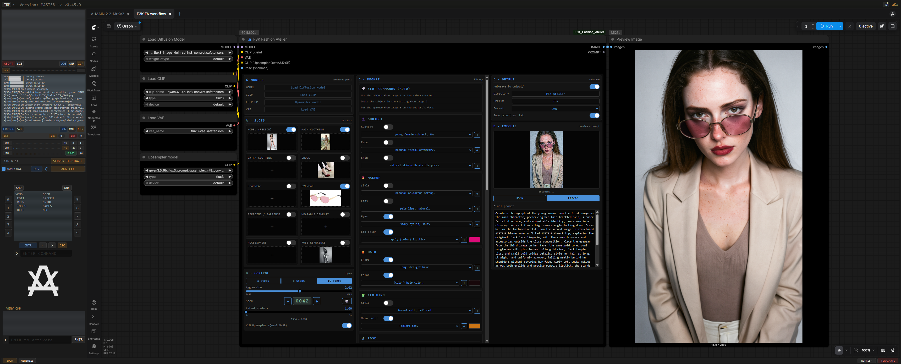

# F3K Fashion Atelier

Fashion atelier combine node for **Flux 3 Klein** in ComfyUI.

Combines reference images (model, clothing, shoes, accessories, pose) into a single
conditioning with slot commands, prompt blocks (JSON / Linear), custom sigmas,
and live preview during sampling.

**Recommended to use with [AKA ComfyUI Shell](https://github.com/Rimor-dev/AKA)** — a companion shell/launcher for ComfyUI.

## Features

- **10 image slots** — model, main/extra clothing, shoes, headwear, eyewear,
  piercing/earrings, wearable jewelry, accessories, pose reference.
- **Prompt constructor** — blocks from `library_studio.json` with single/multi select,
  color picker, manual instruction. JSON or Linear output.
- **Custom sigmas** — 4 / 8 / 16-step profiles (Soft / Base / Hard interpolation)
  with `aggression` slider.
- **VLM Upsampler** (optional) — expand a short prompt using `clip_upsampler`
  (Qwen3.5-9B).
- **Live preview** — decoded `denoised` latent per step, shown in the node UI.
- **Autosave** — output image + `.txt` prompt to `output/F3K_Atelier/`.

**The node appears under F3K/atelier → 👗 F3K Fashion Atelier.**

**No extra Python dependencies beyond what ComfyUI already provides
(torch, numpy, Pillow, aiohttp).**

**ComfyUI: tested on master (v0.45.0 + 22 commits).**

License
MIT
